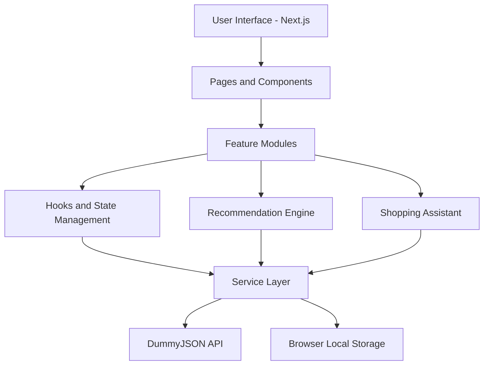
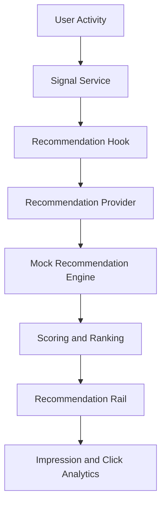
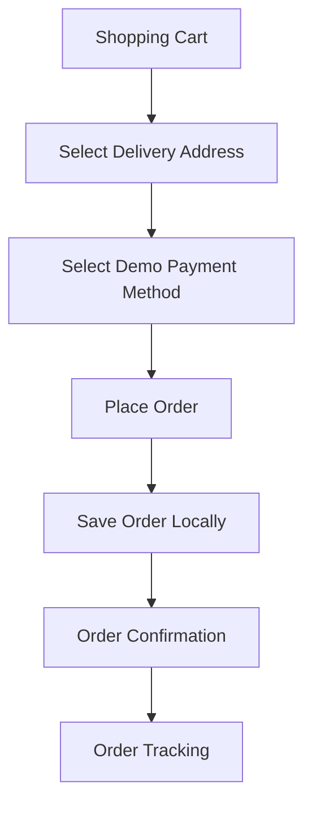
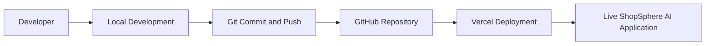

# ShopSphere AI – System Architecture

## 1. Overview

ShopSphere AI is a frontend-focused e-commerce application built with Next.js. It provides product discovery, shopping cart and wishlist management, simulated checkout, customer account features, an AI-style shopping assistant, and a personalized recommendation engine.

The application uses DummyJSON for product data and browser local storage for demo users, orders, inventory overrides, shopping activity, and other local application data.

## 2. Technology Stack

| Technology | Purpose |
|---|---|
| Next.js | Application framework and routing |
| React | Component-based user interface |
| JavaScript | Application logic |
| Tailwind CSS | Responsive styling |
| Zustand | Client-side state management |
| TanStack Query | Server-state and data-fetching support |
| Lucide React | Icons |
| DummyJSON API | Product data source |
| Local Storage | Demo data persistence |
| Vercel | Application deployment |
| GitHub | Source code management |

## 3. High-Level Architecture

The application follows a feature-based frontend architecture. Pages and components handle presentation, feature modules contain domain-specific functionality, and service modules handle data operations.



## 4. Project Structure

The main application folders are organized as follows:

```text
src/
├── app/
│   ├── admin/
│   ├── account/
│   ├── cart/
│   ├── checkout/
│   ├── orders/
│   ├── product/
│   ├── wishlist/
│   └── page.js
│
├── component/
│   ├── layout/
│   └── products/
│
├── features/
│   ├── account/
│   ├── assistant/
│   └── recommendations/
│
├── services/
│   ├── productService.js
│   └── recommendationAnalytics.js
│
└── ...
```

The structure separates application routes, reusable components, feature-specific functionality, and service logic.

## 5. Product Data Flow

1. The application requests product information from the DummyJSON API.
2. The product service handles product retrieval and search operations.
3. Product pages and product components display the retrieved information.
4. Locally managed admin products and inventory overrides are stored in browser local storage.
5. The storefront applies supported local changes when loading product data in the browser.

DummyJSON is used as a demonstration data source. Changes made to its API are not treated as persistent backend database updates.

## 6. State Management and Persistence

Zustand is used for client-side shopping state, including cart and wishlist functionality.

Browser local storage is used for demo persistence, including:

- Shopping cart and wishlist state.
- Demo user and session information.
- Orders and delivery information.
- Admin product and inventory changes.
- Recommendation activity and analytics.
- Shopping assistant conversation history.

Local storage is specific to the browser and website origin. It does not synchronize data across different users or devices.

## 7. Recommendation Engine Architecture

The recommendation engine is designed as a separate feature rather than placing recommendation logic directly inside UI components.

Its high-level flow is:



The engine uses available shopping signals such as recently viewed products, search activity, categories, wishlist items, and cart activity.

It supports nine recommendation strategies:

1. Recently Viewed
2. Similar Products
3. Category-Based
4. Price-Based
5. Wishlist-Based
6. Cart-Based
7. Frequently Bought Together
8. Trending Products
9. Personalized For You

A weighted scoring approach is used to rank recommendations. Explanatory labels help users understand why products are recommended.

The recommendation architecture separates the UI, hooks, service layer, provider contract, and mock engine so that the recommendation implementation can be extended in the future.

## 8. AI Shopping Assistant

The shopping assistant uses a rule-based intent parser and local product-search functionality.

Its main flow:

1. The user enters a shopping query.
2. The intent parser identifies supported information such as category, maximum price, minimum rating, brand, or product similarity.
3. The assistant service processes the interpreted request.
4. Matching products are retrieved.
5. The assistant displays product suggestions and responses.

The assistant supports contextual follow-up queries and fallback responses for unsupported or unclear requests.

**Implementation note:** The current assistant is a rule-based demonstration. It does not use a paid LLM API or a trained machine-learning model.

## 9. Admin Architecture

The admin area provides frontend management functionality for:

- Dashboard overview and local analytics.
- Product management.
- Inventory management.
- Order management.
- Customer information.
- Review management.
- Recommendation analytics.

Admin data changes are managed through local application state and browser storage.

Admin access is controlled using the demo user's role. This is suitable for a frontend demonstration but is not a replacement for secure server-side authorization.

## 10. Checkout and Order Flow

The checkout process demonstrates an e-commerce purchase journey:



The application supports simulated payment methods and order status progression.

No real payment gateway or backend order-processing service is connected.

## 11. Deployment Architecture

The project source code is maintained in GitHub and deployed through Vercel.



**Live application:** https://shopsphere-ai-phi.vercel.app

**GitHub repository:** https://github.com/MayurBhuran/shopsphere-ai

## 12. Current Limitations and Future Improvements

The current implementation is designed as a frontend demonstration. The following improvements can be considered for a production version:

- Integrate a secure backend and database.
- Implement server-side authentication and role-based authorization.
- Replace local demo data with persistent backend storage.
- Integrate a real payment gateway.
- Introduce a production recommendation API or trained recommendation model.
- Add a real LLM-powered shopping assistant if required.
- Expand automated testing and monitoring.
- Improve multi-device data synchronization.

## 13. Conclusion

ShopSphere AI demonstrates a modular frontend e-commerce architecture using Next.js, React, Zustand, Tailwind CSS, and external product data. Its recommendation engine, shopping assistant, customer features, and admin dashboard demonstrate how intelligent shopping experiences can be organized into reusable and extendable application modules.